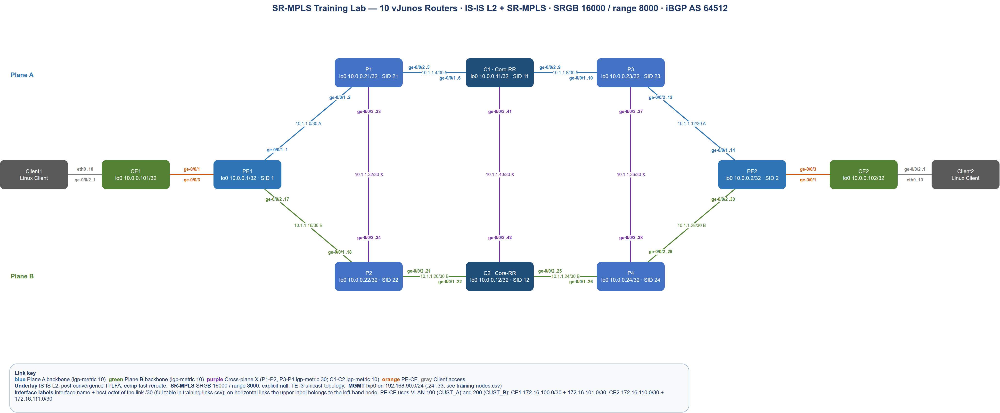

# Junos SR-MPLS Training

A self-paced Graphical Network Simulator-3 (GNS3) lab that takes an engineer from first login on Junos to a working Segment Routing over MPLS (SR-MPLS) provider core: an Intermediate System to Intermediate System (IS-IS) underlay, SR-MPLS transport, Layer 3 Virtual Private Network (L3VPN) services, Flexible Algorithm traffic engineering, Quality of Service (QoS), and Topology-Independent Loop-Free Alternate (TI-LFA) fast reroute. It was built to train working network engineers, and everything needed to rebuild it from nothing is here.

## The Lab

Ten vJunos-router nodes and two Linux clients. Two Provider Edge (PE) routers are joined by two symmetric transit planes, plane A through P1, C1, and P3 and plane B through P2, C2, and P4, with cross-links between the planes so TI-LFA always has a backup path. C1 and C2 double as the BGP route reflectors, and a Customer Edge (CE) router with a Linux client hangs off each PE.

- `topology/sr-mpls-training.png` is the diagram to build from, with every link, subnet, and interface name; the draw.io source sits beside it.
- `training-links.csv` and `training-nodes.csv` are the same wiring and addressing as tables. When the diagram and a table disagree, the table wins, because the configurations are generated from it.

## Modules

| Module | Topic | Handout |
|---|---|---|
| M0 | Junos fundamentals: CLI, candidate configuration, commit and rollback | [M0](guide/handouts/M0-junos-fundamentals.pdf) |
| M1 | IS-IS underlay | [M1](guide/handouts/M1-is-is-underlay.pdf) |
| M2 | SR-MPLS transport | [M2](guide/handouts/M2-sr-mpls-transport.pdf) |
| M3 | L3VPN services | [M3](guide/handouts/M3-l3vpn-services.pdf) |
| M4 | Traffic engineering with Flexible Algorithm | [M4](guide/handouts/M4-traffic-engineering-flexible-algorithm.pdf) |
| M5 | Quality of Service | [M5](guide/handouts/M5-quality-of-service.pdf) |
| M6 | Fast reroute with TI-LFA | [M6](guide/handouts/M6-fast-reroute-ti-lfa.pdf) |
| M7 | Capstone: break, fix, and brief | [M7](guide/handouts/M7-capstone-break-fix-and-brief.pdf) |

Each handout gives the objective, a short concept primer, the exact commands to type, the output you should expect to see, a break/fix exercise, and checkpoints where you explain back what you just built. The combined book is `guide/sr-mpls-training-guide.pdf`. Every handout is also provided as .docx, and all of them are generated from `guide/modules.py`; screenshot placeholders appear as gray codes until images are added under `guide/snaps/`.

## What You Need

- A GNS3 server that can run QEMU virtual machines. Each vJunos node wants about 6 GB of memory, so plan on roughly 64 GB for the full lab. `gns3_baremetal_setup.sh` installs the GNS3 server on Ubuntu 24.04, automating the steps in `GNS3 Server Bare Metal Install.pdf`.
- The Juniper image vJunos-router-24.2R1-S2.qcow2, downloaded from Juniper. It is not included here.
- GNS3 templates named exactly `vJunos-router` (6144 MB, 18 adapters) and `ubuntu24.04` for the clients.
- Python 3.10 or later: `python3 -m venv .venv && .venv/bin/pip install -r requirements.txt`.

## Building It

There is no portable project file; the lab is built by script, which is faster than importing one and does not tie you to a particular server. `instructor-build-guide.md` is the full procedure. In short:

    python generate_lab_configs.py      # writes configs/stage0-base through stage6-frr
    python validate_lab_configs.py      # must print ALL CHECKS PASSED
    python build_gns3_project.py --server http://<gns3-server>:3080 --mgmt-interface <host-nic>
    GNS3_HOST=<gns3-server> python push_stage0_console.py    # base config over the console
    python push_lab_configs.py          # later stages over SSH

The build script creates every node and link, places them to match the diagram, and wires each router's fxp0 to a management switch bridged onto the server's network. If you would rather build by hand, the diagram and `training-links.csv` are all you need, and `configs/stageN/` holds every router's configuration at the end of each module as set commands.

## Before You Run It

The defaults match the network the lab was built on: management addresses 192.168.90.24 through .33, a GNS3 server at 192.168.90.230, and the login `lab` (or `root`) with password `labpassword`. Change the management addressing in `training-nodes.csv` and point the scripts at your server with `--server` and `GNS3_HOST`, then regenerate. The password exists only in these labs; set your own hash in `generate_lab_configs.py` before connecting any of this to a network you care about.

## For Instructors

- `guide/instructor-answer-key.md` holds the fault injections and fixes for every break/fix exercise, so trainees who want to work them cold should not open it.
- `guide/troubleshooting.md` is the eight-step diagnosis flow the capstone is graded against.
- `export_checklist.md` and `contingency-runbook.md` cover moving a built lab between servers.
- `docs/design.md` explains why the lab is shaped the way it is, and `docs/maintainer-notes.md` holds the reference detail for keeping it running.

Prepared by Doug Webb. Licensed under Creative Commons Attribution 4.0 International (CC BY 4.0); see LICENSE. You may share and adapt this material with credit.
